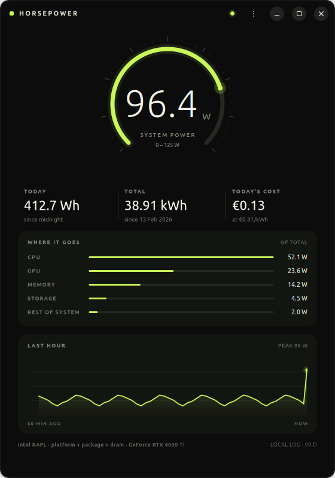
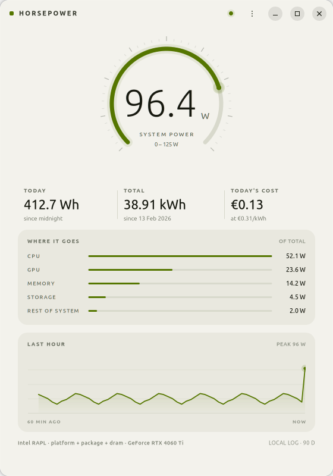

# HorsePower

A small, honest power meter for Ubuntu. It reads the energy counters built into
Intel and AMD processors, shows what the machine is drawing right now, and
keeps a local log in the background so daily and lifetime totals stay correct
even when the window is closed.





## What it does

- **Live power** — the current draw of the whole platform, or of the parts the
  machine can actually measure.
- **Where it goes** — a per-component breakdown: CPU, GPU, memory, storage and
  whatever remains. Rows appear only when that part is genuinely measurable.
- **Today** — energy used since local midnight, with an optional cost.
- **Total** — energy used since HorsePower was installed. Daily totals are kept
  forever.
- **Last hour** — a per-minute chart, drawn with gaps where the machine was
  asleep, so the line never invents data.
- **Background logging** — `horsepowerd` samples once a second as a root
  service, because modern kernels restrict the energy counter to its owner.
  Minute samples are kept for 90 days; the database stays a few megabytes.
  It is written in Rust and uses about 3 MB of memory.

Everything stays on the computer. There is no network code in the package.

## How it measures

Each component has its own hardware interface. HorsePower uses the best one that
exists on the machine and omits the rest instead of inventing numbers.

| Component | Interface | Notes |
| --- | --- | --- |
| Whole platform | RAPL `psys` `energy_uj` | only on some firmwares |
| CPU package | RAPL `package-*` `energy_uj` | cores, cache, uncore |
| Memory | RAPL `dram` `energy_uj` | server-class parts; client parts fold DRAM into the package |
| GPU (NVIDIA) | NVML `nvmlDeviceGetPowerUsage` | `dlopen`, never a link-time dependency |
| GPU (AMD/Intel dGPU) | `hwmon/power1_average` | integrated GPUs are skipped: already inside the package counter |
| Storage | `hwmon/power1_*` | rare; most drives export temperature only |
| Fallback | battery `power_now` | whole-machine draw |

Energy is read as a monotonic microjoule counter, so watt-hours come straight
from hardware deltas rather than from multiplying sampled wattages. Nested RAPL
domains (`core`, `uncore`, `subsystem`) are used for attribution but never
summed into the total, because their energy is already in the parent counter.
Counter wrap-around and implausible deltas are handled explicitly.

### Why the rows always add up

Two rules make the breakdown trustworthy:

1. **`psys` does not include a discrete GPU.** A card's power comes through its
   own VRM, so the GPU figure is added *on top of* the platform total, not
   carved out of the remainder. Subtracting it would understate both the row
   and the headline.
2. **The remainder is only computed against a real platform total.** When only
   `package` counters exist, the interface says "measured parts only" and never
   fabricates a "rest of system" figure.

The daemon smooths every row and then derives the headline as their sum, so the
five numbers on screen can never disagree with each other.

**Honest limitation:** fans are not individually metered by any mainstream Linux
interface — they appear only inside "rest of system" when a platform counter
exists. Displays and USB peripherals are outside `psys` on most desktops, so on
a machine without `psys` the number describes the computer's brain, not the
whole desk. The caption in the window states which of the two you are looking
at.

## Install

```sh
sudo apt install ./horsepower_1.0.0_amd64.deb
```

The package pulls in GTK 4, libadwaita and PyGObject for the window, installs
the desktop entry, icon and the compiled service, enables `horsepower.service`
and starts it. Open **HorsePower** from the application grid.

Check the service:

```sh
systemctl status horsepower.service
journalctl -u horsepower.service -f
```

Inspect the log directly:

```sh
sudo sqlite3 /var/lib/horsepower/power.db 'select * from daily order by day desc limit 7;'
```

## Run from a source checkout

```sh
# terminal 1 - a synthetic sensor that wanders like a real machine
python3 scripts/fake-sensor.py /tmp/fake-sysfs --watts 35

# terminal 2 - the service (build it first: make -C rust/horsepowerd)
rust/horsepowerd/target/release/horsepowerd --bus session \
    --db /tmp/horsepower.db --sysfs-root /tmp/fake-sysfs

# terminal 3 - the window
HORSEPOWER_BUS=session PYTHONPATH=src python3 bin/horsepower
```

Any directory tree with
`powercap/intel-rapl:0/{name,energy_uj,max_energy_range_uj}` works in place of
the fake sensor.

Render the interface to a PNG without a compositor:

```sh
GDK_BACKEND=x11 python3 scripts/preview.py out.png [--light] [--offline] [--no-sensor]
```

## Tests

```sh
make test     # rust and python
```

`cargo test` in `rust/horsepowerd` (55 tests) covers RAPL domain discovery and
priorities, counter wrap, the `psys`/`package`/`dram` attribution rules, the
GPU-over-psys rule, integrated-GPU exclusion, storage, battery fallback,
implausible deltas, the SQLite log (partial buckets, day rollover, pruning),
per-row smoothing, the D-Bus dictionary shape and the CLI parser. The Python
tests cover settings validation and number formatting; the UI is exercised by
`scripts/preview.py`, which renders it under a real GTK stack.

## Architecture

Two processes, one narrow interface between them:

```
rust/horsepowerd/                   the service (Rust)
  src/main.rs                       runtime, D-Bus name, sampling loop, signals
  src/service.rs                    sampling state machine, smoothing, D-Bus surface
  src/power/mod.rs                  Meter: attribution rules, snapshots
  src/power/rapl.rs                 powercap discovery, counter deltas
  src/power/nvml.rs                 NVIDIA power via dlopen
  src/power/hwmon.rs                discrete GPUs and disks
  src/power/battery.rs              battery fallback
  src/store.rs                      SQLite log (samples, daily, meta)
  src/cli.rs                        argument parsing
  src/config.rs                     constants and component labels
  src/logging.rs                    line logging for journald

bin/horsepower                      GUI launcher
src/horsepower/                     the window (Python + GTK 4)
  client.py                         asynchronous Gio.DBusProxy wrapper
  settings.py                       tariff and currency (~/.config/horsepower)
  ui/
    app.py                          GtkApplication, actions, CSS loading
    window.py                       layout, state machine, polling fallback
    gauge.py                        custom Cairo gauge
    breakdown.py                    custom Cairo per-component rows
    chart.py                        custom Cairo history chart
    prefs.py                        Adw.PreferencesDialog
    palette.py                      dark and light colours
    style.css                       typography and surfaces
    formatting.py                   numbers, dates, axis scaling
```

Because the two halves only meet at D-Bus, the service was ported from Python
to Rust without a single change to the GUI.

D-Bus interface `org.horsepower.Daemon` at `/org/horsepower/Daemon`:

- `GetStatus() → a{sv}` — live watts, totals, sensor description, error text,
  and `components: a(ssd)` holding `(key, label, watts)` rows.
- `GetHistory(minutes) → a(xdd)` — `(timestamp, watts, watt_hours)` per minute.
- `StatusChanged(a{sv})`, `HistoryChanged()` signals.

The GUI polls every three seconds as a safety net in addition to the signal,
so a restarted service is picked up without user action.

## Privacy and permissions

The service runs as root because it must read `energy_uj`, which is mode 0400.
It is sandboxed with `ProtectSystem=strict`, `ProtectHome=yes`,
`PrivateDevices=yes`, an empty capability set and a single writable
`StateDirectory`. The D-Bus policy lets any local user call the two read-only
methods and nothing else.

The tariff lives in `~/.config/horsepower/settings.json` (mode 0600). The log is
removed only on `apt purge`.

## License

MIT. See [LICENSE](LICENSE).

## Performance

Measured on Ubuntu 26.04, Ryzen + RTX 4060 Ti, with a real 1 Hz sampling loop,
over a 20-second window (PSS is what the process actually costs the system;
RSS double-counts shared library pages):

| Process | CPU | RSS | PSS |
| --- | --- | --- | --- |
| `horsepowerd` (Rust, RAPL only) | 0.00 % | 5 MB | **2.6 MB** |
| `horsepowerd` (Rust, with NVIDIA driver loaded) | 0.00 % | 25 MB | 20 MB |
| `horsepowerd` (Python, for comparison) | 0.10 % | 55 MB | 36 MB |
| HorsePower window (Python + GTK) | — | 182 MB | — |
| Blank GTK 4 + libadwaita window | — | 156 MB | — |

The daemon is Rust and the GUI is Python, deliberately:

- The **daemon** runs forever as root, so its resident size matters most. Rust
  brings it from 36 MB PSS to 2.6 MB, and from 0.10 % CPU to below measurement
  resolution. The remaining 20 MB when a card is present is the NVIDIA driver
  library itself, which every language pays; it is `dlopen`ed and only when an
  NVIDIA display controller exists, so machines without one never pay it.
- The **GUI** costs only 26 MB more than an empty GTK window. Rewriting it in
  Rust would still link GTK, libadwaita and Mesa, so the saving would be a few
  megabytes while making the drawing and layout code much longer. It stays
  Python.

Neither side is close to a bottleneck: reading three sysfs files and one NVML
call costs about 40 µs per second, against a 1 000 000 µs budget. The language
choice was about resident memory in a process that never exits, not speed.

## Build

### The package

```sh
python3 scripts/build-deb.py           # dist/horsepower_1.0.0_amd64.deb
```

This compiles the Rust daemon and stages the Python GUI into one package. The
package is architecture specific (`amd64` here) because the daemon is a
compiled binary; the Python half is still portable.

### With debhelper (for a PPA or a full source upload)

```sh
sudo apt install debhelper devscripts cargo rustc
dpkg-buildpackage -b -us -uc           # ../horsepower_1.0.0_amd64.deb
```

`debian/rules` runs both test suites and installs the tree via
`scripts/stage.py`.

### The daemon on its own

```sh
cd rust/horsepowerd
cargo test                    # 55 unit tests
cargo build --release         # target/release/horsepowerd, 2.4 MB
cargo clippy --all-targets -- -D warnings
```

It links only `libc` and `libgcc_s`, and SQLite is compiled in, so there is no
`libsqlite3-0` dependency and no version skew.

### Offline builds

Debian and Launchpad build without network access, while `cargo` wants
crates.io. Run this once and commit the result:

```sh
python3 scripts/vendor-rust.py       # rust/horsepowerd/vendor/, ~100 MB
```

`scripts/hpbuild.py` switches to `cargo build --offline` automatically when the
vendored tree is present. It is gitignored by default to keep the repository
small.

## A note on honesty

Power measurement on PCs is easy to get subtly wrong. HorsePower makes four
deliberate choices instead of hiding them:

1. It never extrapolates across a suspend or a clock jump — the interval is
   dropped and the counter re-baselined.
2. It says "system power" only when the firmware provides a platform counter,
   and "measured parts" otherwise.
3. A component with no sensor is omitted, never drawn as a confident 0 W.
4. It keeps gaps in the chart rather than drawing a straight line through
   periods it did not observe.

